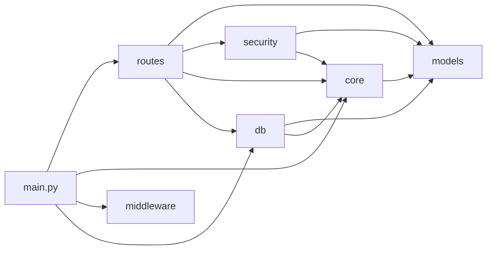

# Customer Support Intent API — Projeto de Bloco (TP1 + TP2)

## Objetivo do projeto

Sistema de atendimento ao cliente apoiado por inteligência artificial. O
repositório reúne a análise dos dados que vão alimentar o classificador de
intenção e a API que vai servi-lo.

**TP1 — domínio, EDA e API base**
1. Documentação e **análise exploratória** do
   [Customer Support Ticket Dataset](https://www.kaggle.com/datasets/suraj520/customer-support-ticket-dataset/data)
   (Kaggle): inspeção inicial, qualidade dos dados, limpeza, análise univariada
   e hipóteses sobre a intenção dos usuários.
2. **API FastAPI** modular com autenticação JWT (`OAuth2PasswordBearer`).
3. **DFD** da API com entradas, saídas, trust boundaries e a tríade CIA.

**TP2 — análise estatística e controles OWASP**
4. **Análise bivariada e testes de hipótese** (correlação, Mann-Whitney,
   qui-quadrado), consolidados em [`docs/relatorio_eda.md`](docs/relatorio_eda.md).
5. **Controles do OWASP Top 10** na API: ownership (BOLA), `extra="forbid"`,
   SQLModel com queries parametrizadas, headers de segurança, CORS com
   allowlist e rate limiting no login.
6. **Auditoria com OWASP ZAP** e tratamento dos findings
   ([`docs/zap_findings.md`](docs/zap_findings.md)).

## Estrutura de pastas

```
.
├── README.md                 # este arquivo
├── pytest.ini                # configuração dos testes (rodar `pytest tests/` da raiz)
├── data/
│   └── customer_support_tickets.csv   # dataset bruto (Kaggle)
├── docs/                     # documentos de entrega (contrato do TP2, relatórios)
├── eda/
│   └── eda.ipynb             # notebook único com toda a EDA
├── tests/                    # testes automatizados da API
├── fastapi/                  # código-fonte da API
│   ├── main.py                # ponto de entrada: monta a aplicação FastAPI
│   ├── db.py                  # engine, sessão e criação das tabelas (SQLModel)
│   ├── requirements.txt
│   ├── core/                  # configuração e infraestrutura transversal
│   │   ├── config.py           # variáveis de ambiente, versão, chaves
│   │   ├── exception_handlers.py # respostas de erro padronizadas
│   │   └── limiter.py          # rate limiting do login
│   ├── routes/                # endpoints da API (camada HTTP)
│   │   ├── health.py           # GET /health
│   │   ├── auth.py             # POST /auth/token
│   │   ├── predict.py          # POST /predict (protegido por JWT)
│   │   └── tickets.py          # CRUD de tickets com verificação de ownership
│   ├── models/                # schemas Pydantic e tabelas SQLModel
│   │   ├── base.py             # StrictModel: base com extra="forbid"
│   │   ├── auth.py, predict.py, ticket.py   # entrada/saída das rotas
│   │   ├── health.py, errors.py             # respostas padronizadas
│   │   └── tables.py           # tabelas User e Ticket (SQLModel)
│   ├── middleware/            # headers de segurança HTTP e CORS
│   └── security/              # autenticação e JWT
│       ├── users.py            # usuário admin in-code (hash bcrypt)
│       └── jwt.py              # emissão/validação de token + OAuth2PasswordBearer
└── others/
    ├── dfd.py                 # script que gera o DFD (fonte versionada)
    └── dfd.png                # DFD da API com trust boundaries e tríade CIA
```

## Arquitetura da API

### Responsabilidade de cada módulo

| Módulo | Responsabilidade | O que **não** faz |
|---|---|---|
| `main.py` | Monta a aplicação: registra middlewares, handlers de erro e routers. É o único que conhece todos os outros módulos. | Não contém regra de negócio nem validação. |
| `routes/` | Camada HTTP: recebe a requisição, declara o schema de entrada e saída, chama as dependências de segurança e devolve a resposta. | Não define schemas (isso é `models/`) nem valida token na mão (isso é `security/`). |
| `models/` | Contrato de dados: schemas Pydantic de entrada/saída, respostas de erro e as tabelas SQLModel. É o módulo mais interno — não importa nenhum outro. | Não acessa banco, não lê requisição, não conhece rotas. |
| `security/` | Autenticação: hash e conferência de senha (`users.py`), emissão e validação do JWT e a dependência `OAuth2PasswordBearer` (`jwt.py`). | Não define rotas; expõe dependências que as rotas consomem. |
| `core/` | Infraestrutura transversal: configuração por variável de ambiente, handlers de erro e rate limiting. | Não conhece rotas específicas. |
| `middleware/` | Headers de segurança HTTP e CORS, aplicados a toda resposta. | Não autentica nem autoriza. |
| `db.py` | Engine do SQLModel, criação das tabelas e a dependência `get_session` (uma sessão por requisição). | Não contém queries de negócio — essas ficam nas rotas. |

### Dependências entre os módulos

O sentido das setas é "importa". Não há ciclos: a dependência sempre aponta da
camada mais externa (HTTP) para a mais interna (contrato de dados).



Em uma frase: **`routes` depende de `models` e de `security`; `security` depende
de `models`; `models` não depende de ninguém.** Por isso é possível testar os
schemas e a emissão de token sem subir a aplicação HTTP.

### Padrão das respostas

Toda rota declara `response_model`, inclusive `GET /health` (`HealthResponse`),
e toda resposta de erro — 401, 404, 422, 429, 500 — sai no mesmo formato
`ErrorResponse`, produzido pelos handlers em `core/exception_handlers.py`:

```json
{
  "code": "unauthorized",
  "message": "Não foi possível validar as credenciais",
  "path": "/predict",
  "fields": null
}
```

`code` é um identificador estável (é por ele que o cliente deve ramificar, não
pela mensagem) e `fields` só aparece em erros de validação (422), listando cada
campo rejeitado. Os formatos estão cobertos por testes em
[`tests/test_contrato_erros.py`](tests/test_contrato_erros.py).

## Dataset

- **Fonte:** [Customer Support Ticket Dataset](https://www.kaggle.com/datasets/suraj520/customer-support-ticket-dataset/data) (Kaggle, autor `suraj520`).
- **Características, motivo da escolha e EDA completa:** ver [`eda/eda.ipynb`](eda/eda.ipynb).
- O CSV usado nesta entrega está versionado em [`data/customer_support_tickets.csv`](data/customer_support_tickets.csv).

## Instalação

Pré-requisito: Python 3.11+ instalado.

```bash
# na raiz do repositório
python -m venv .venv

# Windows (PowerShell)
.venv\Scripts\Activate.ps1
# Windows (Git Bash) / Linux / macOS
source .venv/Scripts/activate   # ou: source .venv/bin/activate

# dependências da API + ferramentas de teste
pip install -r fastapi/requirements-dev.txt

# dependências extras para rodar o notebook de EDA (opcional)
pip install -r eda/requirements.txt
```

## Execução

### API FastAPI

```bash
cd fastapi
uvicorn main:app --reload --no-server-header
```

`--no-server-header` evita que o uvicorn anuncie a própria stack no header
`Server`; a API devolve um valor genérico no lugar.

A API sobe em `http://127.0.0.1:8000`, com documentação interativa em
`http://127.0.0.1:8000/docs`. O banco SQLite é criado na primeira execução, já
com os usuários abaixo (ver [`security/users.py`](fastapi/security/users.py)):

| usuário | senha | para quê |
|---|---|---|
| `admin` | `admin123` | usuário administrativo herdado do TP1 |
| `alice` | `alice123` | usuária comum — demonstra ownership de tickets |
| `bob` | `bob123` | segundo usuário — demonstra o bloqueio de acesso cruzado (BOLA) |


Fluxo de teste manual:

```bash
# 1. Health check (rota pública)
curl http://127.0.0.1:8000/health

# 2. Login -> obtém o token JWT
curl -X POST http://127.0.0.1:8000/auth/token \
  -d "username=alice&password=alice123"

# 3. Cria um ticket (o dono vem do token, nunca do corpo)
curl -X POST http://127.0.0.1:8000/tickets \
  -H "Authorization: Bearer <TOKEN_AQUI>" \
  -H "Content-Type: application/json" \
  -d '{"subject": "Cobranca duplicada", "description": "Fui cobrado duas vezes.", "ticket_type": "Billing inquiry"}'

# 4. Busca o ticket por ID (com o token do BOB, isto devolve 404)
curl http://127.0.0.1:8000/tickets/1 -H "Authorization: Bearer <TOKEN_AQUI>"

# 5. Rota protegida de predição
curl -X POST http://127.0.0.1:8000/predict \
  -H "Authorization: Bearer <TOKEN_AQUI>" \
  -H "Content-Type: application/json" \
  -d '{"text": "I need a refund for my order"}'
```

`POST /predict` ainda **não** roda um modelo de ML: devolve uma intenção
pré-determinada por correspondência de palavras-chave, apenas para simular o
formato de resposta que terá no TP3.

### Notebook de EDA

```bash
# com o venv já ativado (ver seção Instalação)
cd eda
jupyter notebook eda.ipynb
```

## Segurança e DFD

O diagrama de fluxo de dados da API (entidades externas, processos, data
stores, trust boundaries e a tríade CIA aplicada a cada componente) está em
[`others/dfd.png`](others/dfd.png). Os 13 fluxos são numerados, e cada ponto em
que um dado atravessa uma trust boundary é marcado no diagrama com um losango
com o número do fluxo.

O diagrama é gerado por um script versionado — para alterá-lo, edite
[`others/dfd.py`](others/dfd.py) e regere o PNG:

```bash
python others/dfd.py
```

As correções aplicadas a partir do retorno do professor sobre o TP1 estão
documentadas em [`docs/CORRECOES_TP1.md`](docs/CORRECOES_TP1.md).

---

## Segurança — controles do OWASP Top 10 (TP2)

| Risco OWASP | Controle implementado | Onde |
|---|---|---|
| **A01 — Broken Access Control (BOLA)** | `GET /tickets/{id}` compara o dono do recurso com o usuário do token e devolve **404** (não 403) para ticket alheio, para não confirmar a existência do ID. `GET /tickets` filtra pelo dono. `owner_id` nunca vem do corpo da requisição | [`routes/tickets.py`](fastapi/routes/tickets.py) |
| **A02 — Cryptographic Failures** | Senhas só em hash bcrypt; `SECRET_KEY` lida de variável de ambiente; HSTS obrigando HTTPS | [`security/users.py`](fastapi/security/users.py), [`core/config.py`](fastapi/core/config.py) |
| **A03 — Injection** | Toda consulta usa `select()`/`session.get()` do SQLModel, que geram SQL parametrizado. Não há SQL em string no projeto | [`routes/tickets.py`](fastapi/routes/tickets.py), [`security/users.py`](fastapi/security/users.py) |
| **A04 — Insecure Design** | Mensagem de erro idêntica para usuário inexistente e senha errada, e comparação de hash descartável no caminho do usuário inexistente, para não permitir enumeração por timing | [`security/users.py`](fastapi/security/users.py), [`routes/auth.py`](fastapi/routes/auth.py) |
| **A05 — Security Misconfiguration** | HSTS, X-Frame-Options, X-Content-Type-Options, CSP, Referrer-Policy, Permissions-Policy, CORP e banner do servidor genérico; CORS com allowlist explícita; erro 500 sem stack trace | [`middleware/security_headers.py`](fastapi/middleware/security_headers.py), [`core/exception_handlers.py`](fastapi/core/exception_handlers.py) |
| **A05 — CSP da documentação** | `/docs` e `/redoc` têm CSP própria: o `<script>` inline do Swagger é autorizado **pelo hash** (calculado em runtime), sem recorrer a `'unsafe-inline'` | [`routes/docs.py`](fastapi/routes/docs.py) |
| **A07 — Identification and Authentication Failures** | Rate limiting no login; validação de assinatura, expiração e correspondência do `sub` com um usuário existente | [`core/limiter.py`](fastapi/core/limiter.py), [`security/jwt.py`](fastapi/security/jwt.py) |
| **A08 — Data Integrity Failures** | Todos os schemas de entrada herdam de `StrictModel` (`extra="forbid"`): campo desconhecido no corpo devolve 422, fechando a porta para mass assignment | [`models/base.py`](fastapi/models/base.py) |

### Rate limiting do `POST /auth/token`

**Limite configurado: 5 tentativas por minuto, por IP** (`RATE_LIMIT_LOGIN`,
ajustável por variável de ambiente). Ao exceder, a API devolve **429** com o
header `Retry-After`.

**Justificativa técnica.** Sem limite, o `/auth/token` aceita tentativas na
velocidade que o atacante conseguir enviar, e uma senha fraca cai em minutos. Com
5 por minuto, varrer uma lista de mil senhas comuns levaria mais de três horas
por usuário, e um dicionário de um milhão passaria de três meses, tempo
suficiente para o abuso aparecer em qualquer monitoramento. O custo para o
usuário legítimo é nulo: quem lembra a senha erra duas ou três vezes, no máximo.

**Por que por IP e não por usuário:** limitar por nome de usuário permitiria que
um atacante bloqueasse a conta de terceiros só errando a senha de propósito,
transformando a proteção em negação de serviço. Assim o IP garante que será punido o originário do ataque.

**Limitação conhecida:** o contador vive na memória do processo; com mais de uma
instância da API, cada uma teria o seu. Em produção, o storage do slowapi
apontaria para um Redis compartilhado. Registrado em
[`docs/zap_findings.md`](docs/zap_findings.md).

## Testes

```bash
pytest tests/
```

25 testes, executados contra um SQLite em memória (o banco real nunca é tocado):

| Arquivo | O que cobre |
|---|---|
| [`test_seguranca.py`](tests/test_seguranca.py) | Os 3 casos exigidos: acesso sem token (401), acesso a recurso de outro usuário (404) e campo extra no corpo (422) |
| [`test_auth_jwt.py`](tests/test_auth_jwt.py) | Assinatura adulterada, token expirado, token sem `exp` e `sub` que não corresponde a usuário existente |
| [`test_headers.py`](tests/test_headers.py) | Headers de segurança presentes (inclusive em respostas de erro), CSP e allowlist de CORS |
| [`test_rate_limit.py`](tests/test_rate_limit.py) | 429 após exceder o limite, com `Retry-After`; demais rotas não são afetadas |
| [`test_contrato_erros.py`](tests/test_contrato_erros.py) | Formato padronizado de erro em 401, 404 e 422 |
| [`test_smoke.py`](tests/test_smoke.py) | A aplicação sobe e o `/health` responde |

## Auditoria com OWASP ZAP

O relatório exportado está em [`docs/zap_report.html`](docs/zap_report.html) e a
análise dos findings em [`docs/zap_findings.md`](docs/zap_findings.md).

Para reproduzir o scan (passivo, em modo seguro) com a API rodando localmente:

```bash
docker run --rm -v "$(pwd)/docs:/zap/wrk:rw" zaproxy/zap-stable zap-api-scan.py \
  -t http://host.docker.internal:8000/openapi.json -f openapi -S \
  -r zap_report.html -J zap_report.json -I
```

`-S` é o modo seguro: executa apenas o scan passivo, sem disparar ataques contra
a aplicação.
